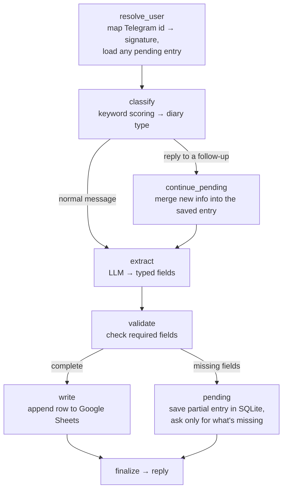

# HACCP Diaries Helper

A Telegram bot that turns a line of chat — a text message, a voice note, or a photo of an invoice — into a structured HACCP food-safety diary entry in Google Sheets. Built as a LangGraph rewrite of an original n8n workflow.

In a working kitchen, HACCP diaries (fridge temperatures, cleaning, incoming goods, pest control, and so on) are usually kept on paper and filled in at the end of a shift from memory. This bot lets staff log an entry the moment it happens, in plain Bulgarian, from the phone already in their hand — and keeps the records consistent and searchable in one spreadsheet.

## What it does

- Accepts **text, voice, and photo/document** messages in Telegram (Bulgarian).
- **Classifies** each message into one of **12 HACCP diary types** using keyword scoring.
- **Extracts** the structured fields for that diary with an LLM.
- **Validates** the required fields. If something is missing it doesn't drop the entry — it remembers the partial record and **asks a follow-up question**, then continues the conversation.
- **Transcribes** voice notes (Whisper) and runs **OCR on invoice photos** (GPT vision) to log incoming-goods line items.
- **Writes** the finished row to the correct sheet in Google Sheets, signed with the sender's name.

## How it works

A single LangGraph `StateGraph` processes each incoming message:



The split is deliberate: **classification is deterministic** (keyword scoring over Bulgarian hints — cheap and predictable), and the **LLM is used only where it earns its place** — pulling structured data out of messy natural language, transcribing audio, and reading invoices.

### Stateful follow-ups

The most useful mechanic. A kitchen message is often incomplete — e.g. "хладилник 2, 6 градуса" with no corrective action. Instead of rejecting it, the bot:

1. saves the partial entry in SQLite with a time-to-live,
2. replies asking only for the missing field,
3. merges the staff member's next reply back into the saved entry and finishes the record.

## Diary types

All 12 are defined in `config/diaries.yaml` — the single source of truth for each diary's sheet name, required fields, and (Bulgarian) column headers:

fridge temperatures · thermal processing · incoming goods · cleaning & disinfection · personal hygiene · waste · pest control · equipment · water control · DDD (pest/rodent treatment) · traceability · complaints

Adding or changing a diary is a YAML edit, not a code change. The Pydantic entry schema mirrors the same fields.

## Tech stack

| Layer | Choice |
|---|---|
| Orchestration | LangGraph (`StateGraph`) |
| LLM | OpenAI via LangChain (`langchain-openai`) |
| Voice | OpenAI Whisper (`whisper-1`) |
| OCR | GPT vision (image → text) |
| Chat | `python-telegram-bot` |
| Storage | Google Sheets via `gspread` + service account |
| Follow-up state | SQLite (TTL-based) |
| Types / validation | Pydantic, typed `GraphState` |
| Tests | pytest (27 test modules) |

## Project structure

```
haccp/
  graph/
    graph.py            # the StateGraph: nodes + edges
    nodes/              # classification, extraction, validation, pending, follow_up, response
  models/               # Pydantic entry schemas + typed graph state
  services/
    sheets.py           # Google Sheets writer
    media.py            # invoice OCR + voice transcription
    pending_store.py    # SQLite follow-up store
  bot.py                # message → graph payload
  telegram_bot.py       # Telegram handlers / long-polling
  config.py             # settings + YAML config loaders
config/
  diaries.yaml          # 12 diary definitions (single source of truth)
  users.example.yaml    # Telegram id → signature map (sample)
tests/                  # 27 pytest modules
```

## Setup

Requires Python 3.11+, an OpenAI API key, a Telegram bot token, and a Google service account with access to your spreadsheet.

1. Install:
   ```bash
   pip install -e .[dev]
   ```
2. Copy `.env.example` to `.env` and fill it in:
   ```
   OPENAI_API_KEY=...
   TELEGRAM_BOT_TOKEN=...
   GOOGLE_SPREADSHEET_ID=...
   GOOGLE_SHEETS_CREDENTIALS_PATH=./service-account.json
   OPENAI_MODEL=gpt-4o-mini
   TIMEZONE=Europe/Sofia
   ```
3. Copy `config/users.example.yaml` to `config/users.yaml` and map Telegram user ids to the signatures that should appear in the sheet.
4. Put your Google service-account JSON at the path above, and share the spreadsheet with the service-account email.

## Running

Process one sample message end-to-end (no Telegram needed):

```bash
python -m haccp.main
```

Start the Telegram bot (long-polling):

```python
from haccp.telegram_bot import run_bot

run_bot()
```

## Tests

```bash
pytest
```

The 27 test modules cover classification, per-diary extraction, the pending / follow-up lifecycle, invoice OCR line items, voice transcription, and signature handling.

## Status & limitations

A personal project, built to practice migrating a real n8n automation into a typed, tested LangGraph service. A few honest notes if you're reading the code:

- The Telegram bot runs on long-polling; there is no webhook or deployment wiring in this repo.
- Required-field validation is structural (is the field present?), not a judgment on whether the logged value is correct.
- Classification is keyword-based, so very terse or unusual phrasings can fall through to `unknown`.

## License

MIT — see [LICENSE](LICENSE).
